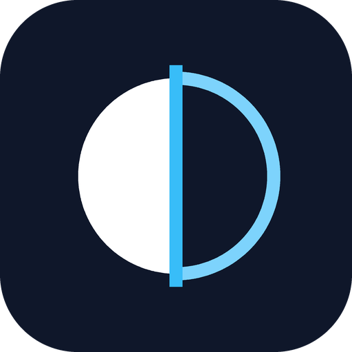
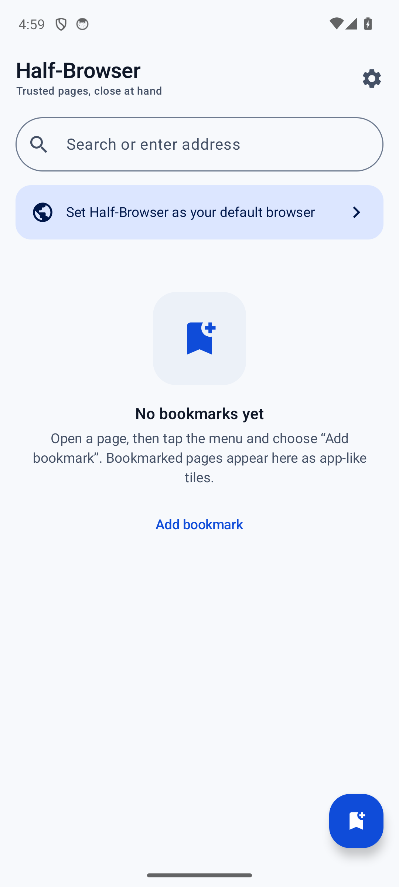
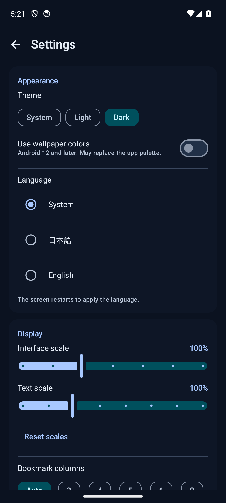
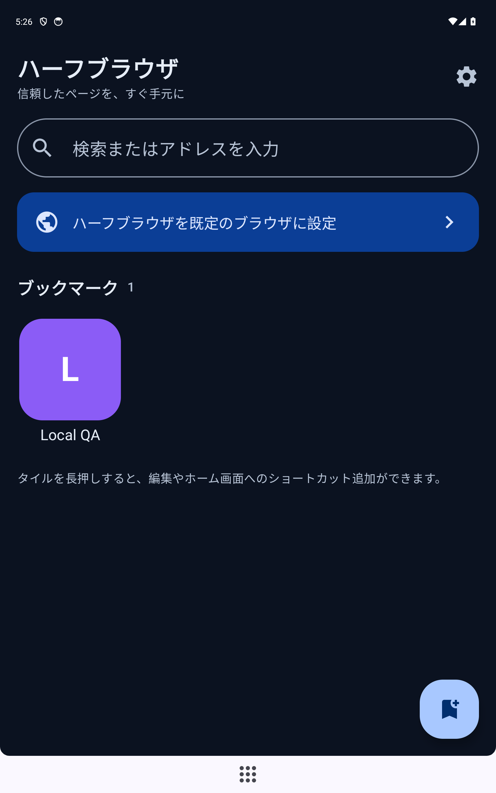

# Half-Browser（ハーフブラウザ）

Android 向けの小さな Chromium ブラウザです。ふつうのブラウザとして使えることに加えて、
**自己署名証明書の HTTPS ページ**（自宅 LAN のサーバーなど）を証明書の中身を確認してから信頼でき、
**HTTP 認証のユーザー名・パスワード**を端末内で暗号化して保存・自動入力できます。

- 作者: 折田悠希 / Yuki_Orita
- ライセンス: MIT
- リポジトリ: https://github.com/oriyu90/half-browser
- 配布: https://github.com/oriyu90/half-browser/releases/latest
- 紹介サイト: https://studio-rizi.pages.dev/projects/half-browser/

<p align="center">
  
</p>

## できること

| 機能 | 内容 |
|---|---|
| ブラウザ | Android System WebView（Chromium）で表示。URL 入力・検索・戻る/進む・再読み込み・共有・PC 版サイト・ダウンロード・JS ダイアログ・新しいウィンドウ（同一タブ）。検索エンジンは Google / DuckDuckGo / Brave / Ecosia / Kagi / Mojeek。 |
| ファイル添付 | `<input type="file">` に対応。画像は「ファイルを選択 / カメラで撮影」を選べます（SAF + FileProvider）。 |
| カメラ・マイク・位置情報 | サイト origin を表示して都度確認。許可時のみ Android の実行時権限を要求し、WebView に許可を渡します。 |
| 全画面動画 | HTML5 動画の全画面表示に対応。戻る操作で解除します。 |
| 自己署名 HTTPS | 証明書エラー時に、ホスト・エラー種別・発行者・Subject・SHA-256 フィンガープリント・有効期限を表示。「今回だけ信頼」「このサイトを常に信頼」を選択。 |
| 証明書のピン留め | 「常に信頼」は **ホスト + ポート + 証明書 SHA-256** 単位で保存（TOFU）。証明書が変わると再確認。設定から失効でき、失効後は次回の読み込みで再確認。期限切れ・ホスト名不一致の証明書は「今回だけ」しか選べません。 |
| HTTP 認証 | Basic / Digest。保存済みなら自動入力（同一 scheme + host + port + realm のみ）。**https 以外では保存も自動入力もしません**。Android Keystore + EncryptedSharedPreferences で暗号化し、バックアップ対象外。設定から削除可能。 |
| テーマ | ライト / ダーク / システム追従。ダークは **純黒の背景 + 白文字**。壁紙の色（Android 12+）を使うオプション。 |
| アクセントカラー | 色相・彩度・明るさのスライダーと 8 色プリセットで UI のアクセントを調整。文字色はコントラスト比 4.5:1 以上を自動で確保します。 |
| バックアップと復元 | ブックマーク・設定（アクセント含む）・信頼した証明書・サイト通知・保存したサインインを 1 つの JSON に書き出し、別の端末の Half-Browser で読み込み（統合 / 置き換え）。パスワードは任意で、選んだパスフレーズによる PBKDF2 + AES-GCM 暗号化のみ。 |
| ホーム | ブックマークをアイコン付きタイルでグリッド表示。アイコンはオフライン生成のモノグラム（1〜2 文字、ユーザー編集可）。長押しで開く・編集・削除・共有・ホーム画面に追加。 |
| 外部リンクの受け取り | `VIEW`（http/https）のブラウザ候補として表示され、他のアプリから選ぶと開けます。ブックマーク済み URL ならブックマーク名を表示する専用バーで開きます。**アプリ内に「既定のブラウザに設定」ボタンはありません**（OS 設定で選びます）。 |
| ホーム画面ショートカット | ブックマークごとにピン留めショートカットを作成（ランチャーの確認つき）。動的ショートカットも同期。 |
| 画面適応 | スマホ縦横・タブレット・折りたたみ。UI スケール 80〜140%、文字スケール 80〜150%、グリッド列数（自動 / 3 / 4 / 5 / 6 / 8）。 |
| 多言語 | 日本語 / English 完全対応（すべての文字列をリソース化）。アプリ内で言語を切り替え可能。 |
| サイト通知 | ブックマークしたページをバックグラウンドで定期確認し、内容が変わったら通知します。監視 ON/OFF、間隔（15/30/60/180分）、Wi-Fi のみ、通知権限、最終確認/エラーを設定で管理。アプリを閉じていても WorkManager が実行します。 |
| プライバシー | 広告・解析・アカウントなし。JavaScript ブリッジなし。`file://` / `content://` アクセス無効。第三者の Cookie 無効。カメラ・マイク・位置情報はサイトごとに都度確認し、許可した訪問中のみ有効です。 |

### 画面

| ホーム（ライト） | 設定（ダーク） | タブレット（日本語） |
|---|---|---|
|  |  |  |

## インストール

1. [Releases](https://github.com/oriyu90/half-browser/releases/latest) から `half-browser-1.2.0.apk` をダウンロードします。
2. 端末で「提供元不明のアプリ」を許可してインストールします。
3. 外部リンクを受け取りたい場合は、Android の設定 → アプリ → 既定のアプリ → ブラウザ で
   Half-Browser を選びます（アプリ内に既定ブラウザ設定ボタンはありません）。

- 対応: Android 8.0（API 26）以降。Android System WebView が更新されている必要があります。
- 実機検証: Sony SOV40（Android 11 / API 30 / WebView 153）で自己署名 HTTPS・認証・失効・
  ブックマーク・ショートカット・外部リンク・テーマ・言語・スケール・横向きを確認済み
  （[docs/DEVICE-QA-SOV40.md](docs/DEVICE-QA-SOV40.md)）。
- 署名証明書 SHA-256: `36:15:3A:ED:27:25:EF:E4:9D:A3:59:F8:F8:71:0E:A9:DE:6E:1D:3F:79:01:F3:53:3E:C9:F8:AF:A2:2A:0F:37`

## ビルド

```bash
# JDK 17 と Android SDK (platform 36.1 / build-tools 36) が必要です。
export JAVA_HOME=/path/to/jdk17
export ANDROID_HOME=/path/to/android-sdk
echo "sdk.dir=$ANDROID_HOME" > local.properties

./gradlew :app:assembleDebug
./gradlew :app:testDebugUnitTest :app:lintDebug
```

署名付きリリース（キーストアは社内の非公開リポジトリで管理しています）:

```bash
KEYSTORE_PATH=/path/to/half-browser-upload-key.jks \
STORE_PASSWORD=... KEY_ALIAS=upload KEY_PASSWORD=... \
./gradlew :app:assembleRelease
apksigner verify --print-certs app/build/outputs/apk/release/app-release.apk
```

`assembleRelease` は署名情報がないと失敗します（未署名 APK を配布しないための意図的な仕様）。

## 構成

```
app/src/main/java/com/yukiorita/halfbrowser/
├── core/       UrlNormalizer, TrustPolicy, Codecs, DeepLinks, GridColumns, AuthAttemptTracker
├── data/       BookmarkRepository, SettingsRepository, TrustRepository, CredentialStore
├── shortcuts/  BookmarkShortcuts（ピン留め・動的ショートカット・モノグラム Bitmap）
├── ui/
│   ├── browser/   WebView ホスト、SSL インタースティシャル、HTTP 認証ダイアログ
│   ├── home/      ブックマークグリッド、検索バー、編集・削除・ショートカット
│   ├── settings/  テーマ・アクセント・言語・スケール・証明書・認証情報・通知・バックアップ
│   └── theme/     Material 3 のライト/ダーク配色
├── AppContainer.kt / MainActivity.kt
└── HalfBrowserApplication.kt
```

設計の詳細は [docs/PLAN.md](docs/PLAN.md)、決定の理由は [docs/ADR/](docs/ADR/)、
検証記録は [docs/FINAL-VERIFICATION.md](docs/FINAL-VERIFICATION.md) を参照してください。

## 制約（正直な記載）

- タブは 1 つです（同時に 1 ページ）。同期・拡張機能・シークレットモードはありません。
- クライアント証明書（mTLS）には対応していません。
- 証明書の信頼は OS の信頼ストアではなく、アプリ内のホスト + 証明書ピンです。
  これは自己署名サーバーを使うための意図的な設計で、CA 検証の代替ではありません。
- Android の仕様上、既定ブラウザはユーザーが OS 設定で選ぶ必要があり、アプリから強制はできません。
  そのため既定ブラウザ設定ボタンは v1.2.0 で削除しました（OS の設定画面から選べます）。
- バックアップのパスフレーズは復元できません。忘れるとパスワードだけ取り込めません
  （ブックマーク等はパスフレーズなしで読み込めます）。
- Kagi はアカウントがないと検索結果を表示しません（ログインはサイト側で行います）。
- サイトのダークモード変換は WebView の対応状況に依存します（非対応でもページは白背景で読めます）。

## セキュリティ

- `intent://` リンクは起動しません（任意コンポーネント起動＝intent redirection の防止）。
- JavaScript ブリッジを公開せず、`file://` / `content://` へのアクセスを無効化。
- 認証情報は https の同一ホスト・ポート・レルムにのみ送信。保存は Keystore 暗号化。
- 証明書の信頼は明示的なユーザー操作でのみ保存され、変更時は必ず再確認します。
- バックアップ（クラウド/端末移行）から認証情報ファイルを除外。

## English

**Half-Browser** is a small Chromium (Android WebView) browser. It lets you inspect and
trust a self-signed HTTPS certificate for one host (TOFU pinning, revocable in Settings),
and store HTTP Basic/Digest credentials encrypted with the Android Keystore. It also has
an app-like bookmark home grid, per-bookmark launcher shortcuts, dark/light/system themes
(dark is true black with white text), a fine-grained accent-colour editor, one-file
backup/restore of every custom item (passwords only as a passphrase-encrypted blob),
adaptive layouts with UI/text scaling, and a full Japanese/English UI. Search engines:
Google, DuckDuckGo, Brave, Ecosia, Kagi and Mojeek.

Requires Android 8.0 (API 26) or later. MIT licensed. No ads, analytics, or accounts.
See [docs/PLAN.md](docs/PLAN.md) and the [ADRs](docs/ADR/) for design decisions.

## 変更履歴

### v1.2.0（2026-11-01）
- 「既定のブラウザに設定」ボタンと設定セクションを削除（OS 設定で選ぶ方式に統一）。
- **バックアップと復元**を追加。ブックマーク・設定・信頼した証明書・サイト通知・保存した
  サインインを 1 つの JSON に書き出し、別端末で「統合」「置き換え」を選んで読み込み。
  パスワードは任意で、パスフレーズによる PBKDF2-HMAC-SHA256（120,000 回）+ AES-256-GCM 暗号化。
  4 MB 上限・件数上限・URL 検証つき。
- **アクセントカラー調整**を追加（色相 0–360°、彩度 15–100%、明るさ 0–100%、プリセット 8 色）。
  文字色は WCAG AA（4.5:1）を満たすよう自動決定。
- ダークモードを **純黒背景 + 白文字** に変更（コンテナのみ近黒）。
- 検索エンジンから Bing を削除し、**Brave / Ecosia / Kagi / Mojeek** を追加。
- 設定画面のバックアップ読み込み直後に、保存済みサインイン一覧が更新されない不具合を修正。

### v1.1.0（2026-11-01）
- ファイル添付（SAF）とカメラ撮影による添付に対応。
- カメラ・マイク・位置情報の Web 権限プロンプトと Android 実行時権限に対応。
- HTML5 動画の全画面表示に対応。
- **サイト通知（ページ更新のバックグラウンド監視）** を追加。WorkManager による 15 分以上の
  定期確認、ブックマーク単位の ON/OFF、間隔・Wi-Fi のみ・通知権限の管理、通知タップで該当ページを開く。
  WebView は Web Push / Notification API を実装していないため、サイト起点のプッシュではなく
  「ブックマークページの変化検知」であることを明記しています。
- バックグラウンド時は WebView のタイマーを停止し、メモリを解放します。

### v1.0.1（2026-11-01）
実機（SOV40 / Android 11）検証で見つかった問題を修正:

- 証明書の信頼を失効しても、アプリを再起動するまで警告が出なかった問題を修正
  （`WebView.clearSslPreferences()` により即時反映）。
- ページ読込前のバータイトルが URL 全体になっていた問題を修正（host:port 表示）。
- HTTP 認証をキャンセルしたときにサーバーの生 `401` が表示されていた問題を修正
  （「サインインが必要です」+ Retry）。
- キーボード表示中にダイアログ外をタップすると入力が消える問題を修正。

### v1.0.0（2026-10-31）
初回リリース。

## 作者

折田悠希（おりたゆうき / Yuki_Orita）
- X: https://x.com/InovateofRIZI
- Discord: https://discord.gg/x7KXhNTD8M
- Website: https://studio-rizi.pages.dev/
